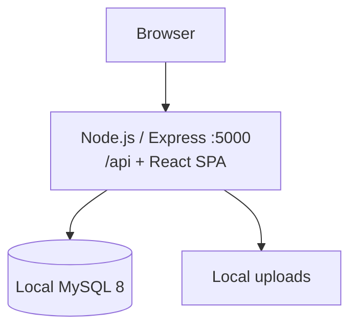

# Campus Complaint Management System (CCMS)
> **Single-server React + Express application backed by MySQL**

CCMS provides a centralized platform for Students, Administrators, and Support Staff to lodge, assign, track, and resolve facility grievances. The current deployment uses local MySQL and local uploads; AWS and S3 integration are not implemented.

---

## 🏛️ System Architecture

CCMS is built as a **simple modular monolith** running on a **single origin**:
- **Frontend**: Single Page Application built with React.js, Vite, and Tailwind CSS.
- **Backend**: Express.js REST API server serving `/api` and the React production bundle from `server/public/`.
- **Database**: Local MySQL 8 accessed through a `mysql2/promise` connection pool.
- **Attachments**: Local server storage under `server/uploads/`.



---

## 🛠️ Technology Stack

| Layer | Technologies |
|---|---|
| **Frontend** | React 19, Vite, JavaScript, Tailwind CSS, React Router v7, Axios, Lucide React |
| **Backend** | Node.js 22 LTS, Express.js, JavaScript, REST APIs, `mysql2/promise`, JWT Authentication, `bcryptjs`, `dotenv`, `express-validator`, `helmet`, `multer` |
| **Database** | MySQL 8 (InnoDB, Parameterized queries, Connection pooling) |
| **File Uploads** | Local files served from `/uploads` |
| **Architecture** | Single-origin Modular Monolith (Stateless backend, no microservices) |

---

## 👥 User Roles & Capabilities

### 1. Student
- **Register & Login**: Self-registration with campus department and phone number.
- **Submit Complaint**: Lodge grievances with category, title, detailed description, and optional image/PDF file attachment.
- **View Own Complaints**: Search and filter by category and status.
- **Track Status**: Inspect resolution progress and full step-by-step history log in real time.

### 2. Admin
- **Dashboard Overview**: Real-time metrics (Total, Pending, Assigned, In Progress, Resolved) and category distribution meters.
- **Grievance Directory**: Filter and search complaints across the campus.
- **Dispatch Staff**: Assign complaints to qualified staff members with assignment notes.
- **Update Status**: Manually transition status if necessary.
- **Staff Directory**: Inspect staff workload (active ticket count) and register new maintenance engineers.

### 3. Staff
- **Assigned Worklist**: View grievance tickets dispatched specifically to the staff member.
- **Update Progress**: Transition complaint status (`IN_PROGRESS`, `RESOLVED`) with resolution remarks.

---

## 🗂️ Complaint Categories & Statuses

### Categories
1. `IT and Wi-Fi`
2. `Electrical`
3. `Infrastructure`
4. `Hostel`
5. `Cleaning`
6. `Other`

### Statuses
1. `PENDING` *(Initial status upon submission)*
2. `ASSIGNED` *(Assigned to maintenance personnel by Administrator)*
3. `IN_PROGRESS` *(Technician on site / active maintenance)*
4. `RESOLVED` *(Issue fixed, audit remarks added)*

---

## 📁 Database Schema

### 1. `users` Table
```sql
CREATE TABLE users (
  id INT AUTO_INCREMENT PRIMARY KEY,
  name VARCHAR(100) NOT NULL,
  email VARCHAR(150) NOT NULL UNIQUE,
  password VARCHAR(255) NOT NULL,
  role ENUM('STUDENT', 'ADMIN', 'STAFF') NOT NULL DEFAULT 'STUDENT',
  phone VARCHAR(20) DEFAULT NULL,
  department VARCHAR(100) DEFAULT NULL,
  created_at TIMESTAMP DEFAULT CURRENT_TIMESTAMP,
  updated_at TIMESTAMP DEFAULT CURRENT_TIMESTAMP ON UPDATE CURRENT_TIMESTAMP,
  INDEX idx_users_email (email),
  INDEX idx_users_role (role)
);
```

### 2. `complaints` Table
```sql
CREATE TABLE complaints (
  id INT AUTO_INCREMENT PRIMARY KEY,
  title VARCHAR(200) NOT NULL,
  description TEXT NOT NULL,
  category ENUM('IT and Wi-Fi', 'Electrical', 'Infrastructure', 'Hostel', 'Cleaning', 'Other') NOT NULL,
  status ENUM('PENDING', 'ASSIGNED', 'IN_PROGRESS', 'RESOLVED') NOT NULL DEFAULT 'PENDING',
  attachment_url VARCHAR(500) DEFAULT NULL,
  student_id INT NOT NULL,
  assigned_staff_id INT DEFAULT NULL,
  created_at TIMESTAMP DEFAULT CURRENT_TIMESTAMP,
  updated_at TIMESTAMP DEFAULT CURRENT_TIMESTAMP ON UPDATE CURRENT_TIMESTAMP,
  INDEX idx_complaints_student (student_id),
  INDEX idx_complaints_staff (assigned_staff_id),
  INDEX idx_complaints_status (status),
  INDEX idx_complaints_category (category),
  CONSTRAINT fk_complaints_student FOREIGN KEY (student_id) REFERENCES users (id) ON DELETE CASCADE,
  CONSTRAINT fk_complaints_staff FOREIGN KEY (assigned_staff_id) REFERENCES users (id) ON DELETE SET NULL
);
```

### 3. `complaint_history` Table (Audit Trail)
```sql
CREATE TABLE complaint_history (
  id INT AUTO_INCREMENT PRIMARY KEY,
  complaint_id INT NOT NULL,
  changed_by INT NOT NULL,
  status ENUM('PENDING', 'ASSIGNED', 'IN_PROGRESS', 'RESOLVED') NOT NULL,
  remarks TEXT DEFAULT NULL,
  created_at TIMESTAMP DEFAULT CURRENT_TIMESTAMP,
  INDEX idx_history_complaint (complaint_id),
  INDEX idx_history_changed_by (changed_by),
  CONSTRAINT fk_history_complaint FOREIGN KEY (complaint_id) REFERENCES complaints (id) ON DELETE CASCADE,
  CONSTRAINT fk_history_changed_by FOREIGN KEY (changed_by) REFERENCES users (id) ON DELETE CASCADE
);
```

---

## 💻 Local Quick Start Guide

### 1. Prerequisites
- Node.js 22 LTS or newer
- MySQL Server 8.0 running locally

### 2. Clone and Setup Environment Variables
Create `.env` inside the `server/` directory (or use `.env.example`):
```env
PORT=5000
NODE_ENV=development

# MySQL Database
DB_HOST=localhost
DB_PORT=3306
DB_USER=ccms_user
DB_PASSWORD=your_mysql_password
DB_NAME=ccms_db

# JWT
JWT_SECRET=<at-least-32-random-characters>
JWT_EXPIRES_IN=1d
```
Generate a secret with `node -e "console.log(require('crypto').randomBytes(32).toString('hex'))"`.

### 3. Install Dependencies
```bash
# Install root, backend, and frontend packages
npm run install:all
```

### 4. Initialize Database & Seed Demo Accounts
```bash
npm run db:init
```

### 5. Build React Client & Start Monolith
```bash
# Build the React client into client/dist and copy it to server/public
npm run build

# Start Express monolith (serves /api and server/public on port 5000)
npm start
```
Visit **http://localhost:5000** in your browser.

*(For active frontend development with hot reloading, run `npm run server` and `npm run client` in separate terminals).*

---

## 🚀 Production Build & Deployment

The production deployment runs one Express server for both the React application and `/api`.

1. Install Node.js 22 LTS (or newer) and MySQL 8.
2. Configure `server/.env` with the production database credentials and a strong, unique `JWT_SECRET`. Do not deploy the example credentials.
3. Install dependencies from the project root with `npm run install:all`.
4. Initialize the schema with `npm run db:init`.
5. Build and copy the frontend bundle with `npm run build`. The generated `client/dist` files are copied into `server/public/`.
6. Start the server with `npm start`.
7. Open `http://localhost:5000`; refresh a nested frontend route to verify the SPA fallback. Check `http://localhost:5000/api/health` for the API.

The frontend uses same-origin `/api` paths, so production does not need a separate frontend server. `npm run db:init -- --force` drops the CCMS tables and must not be used where existing data needs to be preserved.

For Postman API checks, import `postman/CCMS.postman_collection.json` and `postman/CCMS.postman_environment.json`. The execution results and runtime limitations are in [QA_TESTING_REPORT.md](./QA_TESTING_REPORT.md).

---

## 🔑 Default Demo Accounts

| Role | Email | Password | Department / Specialization |
|---|---|---|---|
| **Admin** | `admin@campus.edu` | `Admin@123` | Campus Administration |
| **Staff (IT)** | `staff.it@campus.edu` | `Staff@123` | IT and Wi-Fi |
| **Staff (Electrical)** | `staff.elec@campus.edu` | `Staff@123` | Electrical Maintenance |
| **Student** | `student@campus.edu` | `Student@123` | Computer Science - Hostel B |
| **Student 2** | `ananya@campus.edu` | `Student@123` | Electronics Engg - Hostel A |

*(These credentials are for local evaluation only. Replace them before any non-demo deployment).*

## 🧪 Verification & Health Check

Run the backend API tests from the project root with `npm test`.

The server exposes an automated health check endpoint:
```bash
curl http://localhost:5000/api/health
```
**Response:**
```json
{
  "status": "healthy",
  "timestamp": "2026-11-20T01:23:26.000Z",
  "service": "Campus Complaint Management System API",
  "uptime": 12.4
}
```

---

## 🔒 Security & Best Practices Implemented
- **Parameterized SQL Queries**: Prepared statements via `mysql2/promise` preventing SQL injection.
- **Password Protection**: Passwords securely hashed with `bcryptjs` (salt factor 10); hashes never exposed in API responses.
- **Role-Based Access Control (RBAC)**: Enforced via Express middleware (`STUDENT`, `STAFF`, `ADMIN`).
- **Stateless Backend**: Session state managed via signed JWT tokens.
- **Input Validation**: Request bodies and parameters strictly validated with `express-validator`.
- **Security Headers**: Standard security headers configured via `helmet`.
- **Local Attachments**: Complaint uploads are stored in the server's `uploads/` directory and served from `/uploads`.
